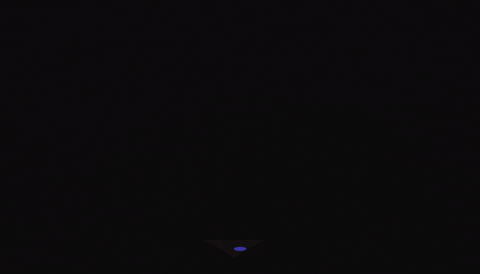

  

  

    

      
    

  

### 👩 About Me 

- I'm a passionate and motivated web developer, fully committed to every project I take on.
-  Detail-oriented and eager to keep learning, I value the quality and impact of the work I deliver. 
- I especially enjoy working as part of a team - sharing ideas, collaborating, and building solutions that are both functional and visually appealing, with a strong interest in frontend development and UI/UX design.

### 💻 Tech Stack:

           

### 📊 GitHub Stats:

### ✍️ Random Quote

